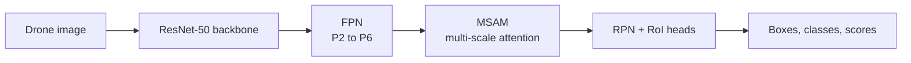
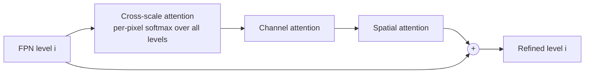

<h1 align="center">Multi-Scale Attention Network for<br>Small Object Detection in Drone Imagery</h1>

<p align="center">
  
  
  
  
  <a href="../../actions/workflows/ci.yml"></a>
</p>

<p align="center">
  A Faster R-CNN detector with a custom <b>Multi-Scale Attention Module (MSAM)</b> on the feature pyramid,
  built to find tiny objects (pedestrians, cars, motorbikes) in aerial images.
</p>

---

## Why this project

Objects in drone images are often smaller than 32×32 pixels, packed together, and surrounded by clutter.
Standard detectors lose them in the deeper layers of the network. This project adds an attention block
that lets each feature-pyramid level borrow useful information from the others and focus on likely object
locations, then measures the effect against strong baselines on [VisDrone](https://github.com/VisDrone/VisDrone-Dataset).

## Architecture



**MSAM** is applied to every pyramid level:



| Component | What it does |
|---|---|
| Cross-scale attention | Fine levels borrow semantics from coarse levels, coarse levels borrow detail from fine ones |
| Channel attention | Re-weights feature channels that matter for small objects |
| Spatial attention | Highlights likely object locations, suppresses background |
| Residual connection | Keeps training stable |

Other small-object adjustments: anchors from 8 to 128 px, 2000 RPN proposals, up to 500 detections per image.

## Results

> Fill this table in after training (`python scripts/compare.py` prints it for you).

| Model | mAP | mAP@50 | AP small | AP medium | AP large |
|---|---|---|---|---|---|
| Faster R-CNN + FPN (baseline) | – | – | – | – | – |
| **Faster R-CNN + FPN + MSAM (ours)** | – | – | – | – | – |
| YOLOv8 | – | – | – | – | – |

**Ablation (MSAM components)**

| Variant | mAP | AP small |
|---|---|---|
| Full MSAM | – | – |
| w/o cross-scale attention | – | – |
| w/o channel attention | – | – |
| w/o spatial attention | – | – |

## Project structure

```
├── config.py              # classes, anchor sizes, image sizes
├── train.py               # training (baseline, MSAM, ablations)
├── evaluate.py            # COCO-style mAP, with AP for small objects
├── app.py                 # Gradio demo (MSAM vs baseline side by side)
├── data/visdrone.py       # VisDrone dataset loader
├── models/
│   ├── attention.py       # Multi-Scale Attention Module
│   └── detector.py        # Faster R-CNN builder
├── scripts/
│   ├── compare.py         # results to markdown table
│   └── train_yolov8.py    # YOLOv8 baseline
└── tests/smoke_test.py    # quick check, no dataset needed
```

## Getting started

```bash
git clone https://github.com/YOUR_USERNAME/visdrone-msan.git
cd visdrone-msan
pip install -r requirements.txt
python tests/smoke_test.py
```

**Dataset.** Download VisDrone2019-DET train and val from the
[official repository](https://github.com/VisDrone/VisDrone-Dataset) and extract:

```
VisDrone/
├── VisDrone2019-DET-train/{images,annotations}
└── VisDrone2019-DET-val/{images,annotations}
```

## Usage

```bash
# Proposed model
python train.py --data VisDrone --out checkpoints/msan.pt --epochs 12
python evaluate.py --data VisDrone --ckpt checkpoints/msan.pt --name msan

# Baseline (identical settings, no attention)
python train.py --data VisDrone --no-attention --out checkpoints/baseline.pt --epochs 12
python evaluate.py --data VisDrone --ckpt checkpoints/baseline.pt --name faster_rcnn_fpn

# Ablations
python train.py --data VisDrone --no-cross   --out checkpoints/abl_no_cross.pt
python train.py --data VisDrone --no-channel --out checkpoints/abl_no_channel.pt
python train.py --data VisDrone --no-spatial --out checkpoints/abl_no_spatial.pt

# YOLOv8 baseline
python scripts/train_yolov8.py --epochs 50

# Results table
python scripts/compare.py

# Interactive demo
python app.py --msan checkpoints/msan.pt --baseline checkpoints/baseline.pt
```

A GPU is strongly recommended (a free Colab or Kaggle T4 works). For a quick debug run add `--max-images 200 --epochs 1`.

## Demo

Add a screenshot of the Gradio app here after you run it:

```markdown

```

## Acknowledgements

- [VisDrone dataset](https://github.com/VisDrone/VisDrone-Dataset): Zhu et al., *Detection and Tracking Meet Drones Challenge*, TPAMI 2021
- [torchvision](https://pytorch.org/vision/) detection models
- CBAM: Woo et al., *CBAM: Convolutional Block Attention Module*, ECCV 2018
- [Ultralytics YOLOv8](https://github.com/ultralytics/ultralytics) for the baseline

## License

MIT, see [LICENSE](LICENSE).
